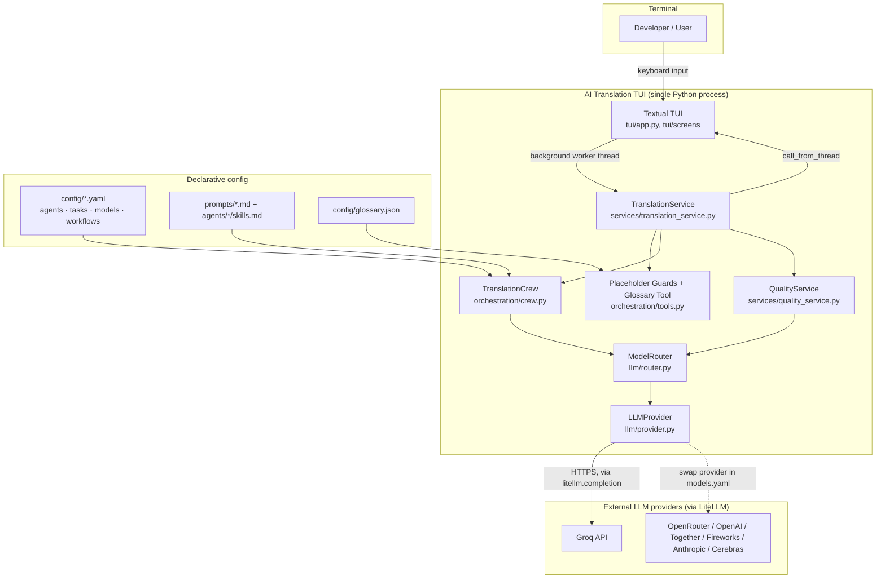
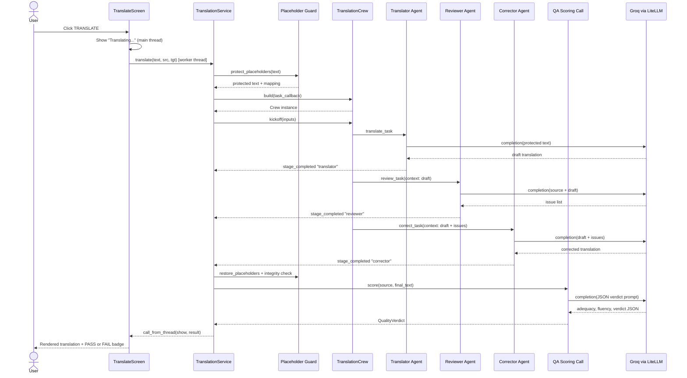
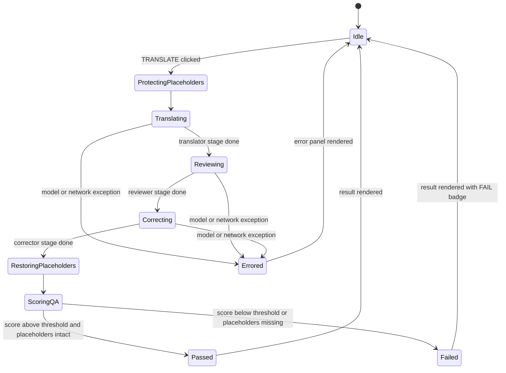
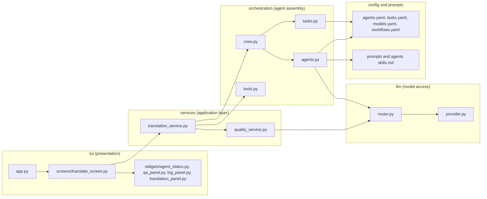

# AI Translation TUI

**A production-grade, multi-agent AI translation pipeline running in your terminal.**

Four specialist AI agents — Translator, Reviewer, Corrector, and QA — pass a piece of text through a strict sequential pipeline to produce a translation that is faithful, fluent, and automatically scored before you ever see it. Everything runs in a [Textual](https://textual.textualize.io/) TUI, backed by [CrewAI](https://www.crewai.com/) for orchestration and [LiteLLM](https://www.litellm.ai/) for provider-agnostic model access (Groq by default, with OpenRouter/OpenAI/Together/Fireworks/Anthropic/Cerebras all one config change away).


---

## Table of contents

- [Problem statement](#problem-statement)
- [How it works](#how-it-works)
- [Architecture](#architecture)
- [Technology stack](#technology-stack)
- [Pipeline lifecycle trace](#pipeline-lifecycle-trace)
- [Data flow](#data-flow)
- [Diagrams](#diagrams)
- [Project structure](#project-structure)
- [Prerequisites](#prerequisites)
- [Installation](#installation)
- [Configuration](#configuration)
- [Running the app](#running-the-app)
- [Testing](#testing)
- [Engineering decisions and known gotchas](#engineering-decisions-and-known-gotchas)
- [Troubleshooting](#troubleshooting)
- [Roadmap](#roadmap)
- [Contributing](#contributing)
- [License](#license)

---

## Problem statement

Single-pass machine translation from one LLM call is fast but unreliable: it silently drops content, mistranslates idioms, breaks formatting placeholders (URLs, code, HTML), or leaves fragments of the source language behind. There is no second opinion and no objective way to know whether a translation is good enough to ship.

**AI Translation TUI** treats translation as a *pipeline*, not a single API call — mirroring how a professional localization team works: a translator drafts, a reviewer critiques without touching the text, an editor applies only the flagged fixes, and a QA gate scores the result before it's accepted.

## How it works

```
Source text
    │
    ▼
[1] Translator  ── drafts a fluent {target_lang} translation, consults the glossary
    │
    ▼
[2] Reviewer    ── critiques the draft against the source (does NOT rewrite it)
    │
    ▼
[3] Corrector   ── applies only the reviewer's flagged issues
    │
    ▼
[4] QA Gate     ── scores adequacy + fluency, confirms language & terminology, pass/fail
    │
    ▼
Final translation + verdict
```

Two deterministic guarantees wrap the whole pipeline and never depend on the model behaving well:

- **Placeholder protection** — every URL, email, `inline code`, `{template}` variable, `%s`/`%d` format specifier, and HTML tag is swapped for an opaque `⟦N⟧` sentinel *before* any text reaches an LLM, and restored afterward. A model can mistranslate a sentence; it can never corrupt a URL, because it never saw the URL.
- **Placeholder integrity check** — after the pipeline finishes, every sentinel is verified present in the output. A missing sentinel is an automatic QA fail, no model judgment required.

## Architecture



**Why this shape:** the TUI, the pipeline orchestration, and the model access layer are three independently swappable seams. `TranslationService` is the only thing the UI talks to (§ [Engineering decisions](#engineering-decisions-and-known-gotchas)); it doesn't know CrewAI exists. `ModelRouter` is the only thing that talks to a model; the agents don't know Groq exists. Swapping Textual for a web UI, or CrewAI for a hand-rolled loop, or Groq for OpenAI, each touches exactly one layer.

## Technology stack

| Technology | Version constraint | Category | Purpose in this project | Why chosen |
|---|---|---|---|---|
| [Python](https://www.python.org/) | `>=3.10,<3.14` | Language runtime | Entire application | Async-friendly stdlib, mature ML/LLM ecosystem, target audience of the internship project |
| [CrewAI](https://www.crewai.com/) | `>=0.130` | Multi-agent orchestration | Defines the Translator/Reviewer/Corrector agents and runs them as a sequential `Crew` | Declarative `Agent`/`Task`/`Crew` model maps directly onto a translate → review → correct pipeline without hand-rolling a state machine |
| [crewai-tools](https://github.com/crewAIInc/crewAI-tools) | `>=0.40` | Agent tooling | Provides the `@tool` decorator used for the (currently unused-by-agents) glossary/language tools | Ships with CrewAI's tool-calling contract |
| [Textual](https://textual.textualize.io/) | `>=0.80` | TUI framework | Renders the terminal UI (`tui/app.py`, `tui/screens/translate_screen.py`), reactive widgets, async workers | Modern, CSS-styled, async-native TUI framework with a proper worker/threading model for keeping long LLM calls off the UI thread |
| [LiteLLM](https://www.litellm.ai/) | `>=1.0` | LLM gateway | Routes every model call to the correct provider from a single `model` slug (`groq/...`, `openrouter/...`) | One integration surface for 100+ providers; lets `models.yaml` alone decide who serves each agent role |
| [PyYAML](https://pyyaml.org/) | `>=6.0` | Config parsing | Loads `config/agents.yaml`, `models.yaml`, `tasks.yaml`, `workflows.yaml` via `yaml.safe_load` | Human-editable, diffable pipeline configuration with zero code changes needed to retune the system |
| [python-dotenv](https://github.com/theskumar/python-dotenv) | `>=1.0` | Configuration | Loads `GROQ_API_KEY` / provider keys from `.env` into the process environment at startup | 12-factor-style secret separation from source control |
| [langdetect](https://github.com/Mimino666/langdetect) | `>=1.0.9` | Deterministic language ID | `orchestration/tools.py:_detect()` — confirms the final output is actually written in the target language | A hard, non-LLM check catches the specific failure mode of a model silently answering in the wrong language |
| [Pydantic](https://docs.pydantic.dev/) | (via CrewAI) | Data validation | `QAReport` model in `orchestration/tasks.py` | Typed, validated structure for QA scoring fields (`adequacy`, `fluency`, bounded `0–1`) |
| [Rich](https://rich.readthedocs.io/) | (via Textual) | Terminal rendering | `rich.markup.escape` sanitizes model output before it's rendered as TUI markup | Prevents a model response containing `[` / `]` from being interpreted as Rich markup and breaking the display |
| [uv](https://docs.astral.sh/uv/) | — | Package/dependency manager | `uv.lock` lockfile, `uv run` entry point | Fast, reproducible dependency resolution for the project |
| [Hatchling](https://hatch.pypa.io/) | — | Build backend | `[build-system]` in `pyproject.toml`, explicit `packages = [...]` for the flat (non-`src/`) layout | Declared build backend for the `ai-translation-tui` package |

**LLM providers supported out of the box** (one config edit in `config/models.yaml` away from each other): Groq (default), OpenRouter, Together AI, Fireworks AI, OpenAI, Anthropic, Cerebras — anything else LiteLLM supports works by adding its key-env mapping to `llm/provider.py:_PROVIDER_KEY_ENV`.

## Pipeline lifecycle trace

### Request: user clicks "TRANSLATE" in the TUI

```
1. UI EVENT
   └── Button.Pressed on #run
       → tui/screens/translate_screen.py : TranslateScreen._go()
       → Reads #source (TextArea), #src / #tgt (Input) values
       → Immediately updates #status on the MAIN thread ("Translating…")
         so the click is acknowledged before any network call happens

2. BACKGROUND WORKER
   └── @work(exclusive=True, thread=True) TranslateScreen._run()
       → Runs off the Textual event loop so a slow LLM call never freezes the UI
       → Calls: self._service.translate(text, src, tgt, on_event)

3. SERVICE ENTRY
   └── services/translation_service.py : TranslationService.translate()
       → Logs to translation.log (file only — a StreamHandler would corrupt
         the TUI's own terminal rendering)
       → protect_placeholders(source_text) → sentinel-protected text + mapping
         (orchestration/tools.py)

4. CREW ASSEMBLY
   └── orchestration/crew.py : TranslationCrew.build()
       → AgentFactory.build_all() constructs Translator, Reviewer, Corrector
         Agents — role/goal/backstory from config/agents.yaml, prompt body
         from prompts/<name>.md, tactical checklist from agents/<name>/skills.md
       → Each Agent's `llm` comes from ModelRouter.for_role(name) → a cached
         crewai.LLM built by LLMProvider from config/models.yaml
       → TaskFactory.build_all() wires translate_task → review_task (context=
         [translate]) → correct_task (context=[translate, review])
       → Crew(process=Process.sequential, memory=False, max_rpm=25,
              task_callback=_task_done)

5. KICKOFF
   └── crew.kickoff(inputs={source_text, source_lang, target_lang})
       → CrewAI runs Translator → Reviewer → Corrector strictly in order,
         each stage receiving the prior stages' raw output as context
       → After each stage, _task_done() fires: restores placeholders in that
         stage's output, stores it, emits a `stage_completed` PipelineEvent

6. MODEL CALL (per stage, per agent)
   └── crewai.LLM.call() → litellm.completion(model="groq/...", messages=[...])
       → llm/provider.py's cache_breakpoint stripper removes CrewAI's
         Anthropic/OpenRouter-only message field before the request goes out
         (Groq rejects it with a 400 otherwise)
       → DISABLE_AIOHTTP_TRANSPORT forces LiteLLM onto the sync httpx client
         (the aiohttp transport hangs forever inside a Textual thread worker
         on Windows — no usable event loop in that thread)
       → On 429, LiteLLM retries with backoff (num_retries in models.yaml)

7. QA SCORING (not a crew agent — a direct, tool-free LLM call)
   └── TranslationService._run_qa()
       → router.for_role("qa").call([...]) with the qa backstory as system
         prompt and {source, final_text} as the user prompt
       → _parse_json() extracts the JSON verdict, tolerating code fences
       → Hard, deterministic overrides: missing placeholders or QA failure
         to answer at all NEVER silently pass — see quality_service.py

8. RESPONSE ASSEMBLY
   └── TranslationResult{final_text, stages, verdict, elapsed} returned
       → self.app.call_from_thread(self._show, result)  — the ONE
         cross-thread UI call in the whole run, at the very end

9. UI RENDER
   └── TranslateScreen._show() → #output shows the (rich-escaped) final text
       → #status shows elapsed time + colour-coded QA PASS/FAIL + score
```

### Error path

If `crew.kickoff()` raises (model outage, exhausted 429 retries, malformed provider response) and no corrector output was produced yet, the exception propagates out of `translate()`. The worker's `try/except` in `TranslateScreen._run()` catches it, calls `self.app.call_from_thread(self._fail, str(exc))`, and the UI shows a red `Error:` panel pointing at `translation.log` for the full traceback — the process never crashes, and every step up to the failure is already in the log file.

## Data flow

```
User input (source text, source_lang, target_lang)
    │
    ▼  protect_placeholders()               [orchestration/tools.py]
Protected text  +  {sentinel → original} mapping
    │
    ▼  Crew.kickoff(inputs)                 [orchestration/crew.py]
    ▼  Translator Task   → draft translation (context: source)
    ▼  Reviewer Task     → issue list        (context: source + draft)
    ▼  Corrector Task    → corrected text    (context: source + draft + issues)
    │
    ▼  restore_placeholders() per stage      [orchestration/tools.py]
    ▼  placeholder_integrity() check         [orchestration/tools.py]
    │
    ▼  QA scoring call (direct LLM, JSON)    [services/translation_service.py]
    ▼  QualityVerdict{passed, score, reasons}
    │
    ▼  TranslationResult
    │
    ▼  call_from_thread → Textual reactive UI update
Rendered output + PASS/FAIL badge in the terminal
```

Every stage boundary is a plain Python object (`TaskOutput`, `PipelineEvent`, `TranslationResult`, `QualityVerdict`) — there is no database and no network boundary between stages beyond the LLM calls themselves. State lives only for the duration of one `translate()` call; nothing persists between runs except the append-only `translation.log` file.

## Diagrams

<details>
<summary><strong>Sequence diagram — one translation run</strong></summary>



</details>

<details>
<summary><strong>State diagram — one pipeline run</strong></summary>



</details>

<details>
<summary><strong>Component diagram — module dependencies</strong></summary>



</details>

## Project structure

```
ai-translation-tui/
├── main.py                      # Composition root: env setup, logging, wires TranslationService into the TUI
├── smoke_test.py                # Runs the pipeline headless (no TUI) for isolating model/pipeline vs UI bugs
├── pyproject.toml                # uv/Hatchling project + dependency manifest
├── uv.lock                       # Locked dependency versions
├── .env / .env.example           # GROQ_API_KEY (or your chosen provider's key)
├── translation.log                # Full DEBUG-level run log (file-only; never written to stdout)
│
├── config/                       # Declarative pipeline configuration — no code changes needed to retune
│   ├── agents.yaml                # WHO each agent is: role / goal / backstory
│   ├── tasks.yaml                 # WHAT each stage does: task description + expected_output templates
│   ├── models.yaml                # WHICH model/provider serves each role, temperature, token/retry limits
│   ├── workflows.yaml             # Pipeline stage order, QA pass threshold, runtime knobs (max_rpm, verbose)
│   └── glossary.json              # Approved term → required translation mappings
│
├── prompts/                       # Long-form prompt bodies, one per agent (merged into backstory at build time)
│   ├── translator.md
│   ├── reviewer.md
│   ├── corrector.md
│   └── qa.md
│
├── agents/<name>/skills.md        # Tactical checklists per agent, merged in as the third layer of backstory
│   ├── translator/skills.md
│   ├── reviewer/skills.md
│   ├── corrector/skills.md
│   └── qa/skills.md
│
├── orchestration/                 # CrewAI wiring — assembles Agents, Tasks, and the Crew from config
│   ├── crew.py                     # TranslationCrew: the only file that imports both factories
│   ├── agents.py                   # AgentFactory: builds the 3 pipeline Agents
│   ├── tasks.py                    # TaskFactory: builds the 3 sequential Tasks + QAReport model
│   └── tools.py                    # Glossary/language @tools + deterministic placeholder protect/restore/verify
│
├── llm/                            # Provider-agnostic model access — the ONLY place LLM clients are built
│   ├── provider.py                  # ModelSpec → crewai.LLM factory; cache_breakpoint stripper for non-Anthropic providers
│   └── router.py                    # Role → LLM resolver with automatic fallback-model + 429 retry handling
│
├── services/                       # Business logic layer between the UI and the crew
│   ├── translation_service.py       # Runs protect → kickoff → restore → QA-score → TranslationResult
│   └── quality_service.py           # Authoritative quality gate: hard checks + model judgment + optional back-translation
│
└── tui/                             # Textual presentation layer
    ├── app.py                        # TranslationApp: App subclass, bindings, pushes the first screen
    ├── styles/app.tcss                # Textual CSS
    ├── screens/translate_screen.py    # The (currently only) screen: form, worker thread, result rendering
    └── widgets/                       # agent_status.py, qa_panel.py, log_panel.py, translation_panel.py
```

## Prerequisites

- **Python 3.10 – 3.13** (constrained in `pyproject.toml`)
- **[uv](https://docs.astral.sh/uv/)** — recommended, used for the lockfile and `uv run`. `pip install uv` if you don't have it.
- A free **Groq API key** — [console.groq.com/keys](https://console.groq.com/keys) (default provider; 30 req/min free tier, far more headroom than most alternatives for a 3-agent sequential pipeline)
- A terminal that supports a modern TUI (any standard terminal on Windows Terminal, macOS Terminal/iTerm2, or a Linux terminal emulator)

## Installation

```bash
git clone https://github.com/KARTHIKAKRISHNA123/tui-transeditor.git
cd tui-transeditor

# Install dependencies (creates .venv automatically)
uv sync

# Configure your API key
cp .env.example .env
```

Edit `.env`:

```ini
GROQ_API_KEY=gsk_your_key_here
```

## Configuration

All pipeline behavior is controlled from `config/*.yaml` — no Python changes required for most tuning.

| File | Controls |
|---|---|
| `config/agents.yaml` | Each agent's `role`, `goal`, and `backstory` (merged with `prompts/<name>.md` and `agents/<name>/skills.md` at build time — "one fact, one home") |
| `config/tasks.yaml` | Each pipeline stage's instructions and `expected_output` template, with `{source_lang}` / `{target_lang}` / `{source_text}` placeholders filled from kickoff inputs |
| `config/models.yaml` | Which provider + model serves each role (`translator`, `reviewer`, `corrector`, `qa`, `fallback`), plus `temperature`, `timeout`, `max_tokens`, `num_retries` |
| `config/workflows.yaml` | Pipeline stage order, `pass_threshold` for QA, `enable_back_translation`, `max_rpm`, `verbose` |
| `config/glossary.json` | Term → required-translation pairs enforced via the glossary lookup tool |

### Environment variables

| Variable | Required | Description |
|---|---|---|
| `GROQ_API_KEY` | Yes (default provider) | Groq API key, read by `llm/provider.py` |
| `OPENROUTER_API_KEY` | Only if switching provider to OpenRouter | See below |
| `TOGETHER_API_KEY` / `FIREWORKS_API_KEY` / `OPENAI_API_KEY` / `ANTHROPIC_API_KEY` / `CEREBRAS_API_KEY` | Only if you set that provider for a role | Matching provider key |
| `LITELLM_LOCAL_MODEL_COST_MAP` | Set automatically by `main.py` | Skips a slow GitHub fetch for LiteLLM's cost map on startup |
| `DISABLE_AIOHTTP_TRANSPORT` | Set automatically by `main.py` / `smoke_test.py` | Forces LiteLLM onto the sync httpx transport — required for the Textual thread worker to complete on Windows |

### Switching LLM providers

Change any role's block in `config/models.yaml`:

```yaml
roles:
  translator:
    provider: openrouter
    model: openrouter/<org>/<model>:free
    base_url: https://openrouter.ai/api/v1
    temperature: 0.7
    timeout: 60
    max_tokens: 1024
    num_retries: 5
```

...and put `OPENROUTER_API_KEY` in `.env`. Mixing providers per role (e.g., a stronger model for the Reviewer, a cheap fast one for the Translator) works out of the box.

## Running the app

```bash
uv run python main.py
```

1. Fill in **SOURCE LANGUAGE** and **TARGET LANGUAGE** (defaults: English → Tamil)
2. Type or paste text into **SOURCE TEXT**
3. Press **TRANSLATE** (or click)
4. Watch the status line for progress; the final translation and a **PASS/FAIL** QA badge with score appear in the output panel

Keybindings: `q` / `Ctrl+C` quit, `Ctrl+L` clear the log panel.

Full run logs (every CrewAI/LiteLLM/agent log line, DEBUG level) are written to `translation.log` in the project root — nothing is printed to stdout, since that would corrupt the TUI's own terminal rendering.

## Testing

```bash
# Headless pipeline check — bypasses the TUI entirely to isolate whether a
# failure is in the model/pipeline layer or the Textual worker layer.
uv run python smoke_test.py
```

`smoke_test.py` prints each pipeline stage as it happens, makes one raw LLM call before running the full crew (to confirm the API key and model slug work at all), and prints a full traceback on any failure.

> ℹ️ *No automated unit/integration test suite currently exists in the repository — `smoke_test.py` is the project's manual end-to-end check. See [Roadmap](#roadmap).*

## Engineering decisions and known gotchas

These are documented directly in code comments and are worth knowing before modifying the pipeline:

- **No tools on the pipeline agents.** `AgentFactory` deliberately passes `tools={}` to every agent. Free-tier models (Llama 4 Scout, etc.) handled CrewAI's ReAct tool-calling loop badly — burning turns on tool reasoning, leaking meta-commentary into the output, and losing context between stages. Glossary lookup and language detection exist as `@tool`-decorated functions in `orchestration/tools.py` but are currently invoked by the *service layer*, not by agent reasoning; placeholder protection is deterministic code for the same reason — a guarantee, not a suggestion the model might follow.
- **`cache_breakpoint` stripping.** CrewAI tags messages with a `cache_breakpoint` field to enable Anthropic/OpenRouter prompt caching. Groq rejects unknown fields with a 400. `llm/provider.py` monkey-patches `litellm.completion` at import time to strip that field from every outgoing request, so any provider accepts the payload.
- **`DISABLE_AIOHTTP_TRANSPORT=True`.** LiteLLM ≥1.89 defaults to an aiohttp transport, which hangs forever when CrewAI's synchronous `kickoff()` runs inside a Textual `@work(thread=True)` worker on Windows (no usable event loop in that background thread). Forcing the sync `httpx` transport fixes it. This must be set *before* `litellm`/`crewai` are imported — see the top of `main.py`.
- **File-only logging.** A `StreamHandler` would print into the same terminal Textual is rendering to and corrupt the TUI. All logging goes to `translation.log` only.
- **QA is a direct LLM call, not a crew Task.** An earlier QA agent/task was removed from `orchestration/tasks.py` (commented "was the only source of model errors") — the corrector's output is treated as the final translation, and QA scoring now runs as a single tool-free `router.for_role("qa").call(...)` returning structured JSON, parsed defensively in `TranslationService._run_qa` so a QA failure never sinks a completed translation.
- **Deterministic quality gate.** `QualityService`/`_run_qa` never trust the model alone: missing placeholder sentinels or a wrong output language are hard, code-level fails regardless of what the QA model claims.
- **`max_rpm=25`**, just under Groq's 30 req/min free-tier ceiling, and `num_retries` with backoff on 429s, so the pipeline survives rate limiting rather than crashing mid-run.

## Troubleshooting

| Symptom | Cause | Fix |
|---|---|---|
| TUI hangs on "Already running" / never returns after clicking TRANSLATE | `aiohttp` transport deadlock in the background thread (Windows) | Confirm `DISABLE_AIOHTTP_TRANSPORT=True` is set before any `litellm`/`crewai` import — already default in `main.py`; don't reorder imports |
| `RuntimeError: GROQ_API_KEY is not set` | Missing/empty `.env` | Copy `.env.example` → `.env` and paste your key |
| `BadRequestError: property 'cache_breakpoint' is unsupported` | Provider doesn't accept CrewAI's cache-breakpoint field | Should already be patched by `llm/provider.py`; if it recurs after a CrewAI upgrade, check the field name hasn't changed |
| Frequent `429` errors / pipeline stalls for ~35s repeatedly | Free-tier rate limit hit | Lower `max_rpm` in `config/workflows.yaml`, or reduce `max_tokens` per role in `models.yaml` |
| Output still contains source-language text | Model didn't fully translate | Reviewer/Corrector should catch this; if it slips through, check `translation.log` for the QA verdict's language check, and consider raising `pass_threshold` |
| A URL/placeholder got mangled in the output | Should be prevented by `protect_placeholders` | Check `translation.log` for `placeholder_integrity` — a missing-sentinel entry means the model saw raw text instead of a sentinel; verify the regex in `orchestration/tools.py:_NON_TRANSLATABLE` actually matches your input format |
| Garbled/broken TUI rendering after a run | A stray `print()`/`logging.StreamHandler()` writing to stdout | All logging must stay file-only; check for print statements added during debugging (see the various `debug_*.py` scripts in the repo root, kept as reference for past UI-freeze investigations) |

## Roadmap

> ℹ️ *No roadmap file exists in the repository; the items below are inferred gaps based on the current codebase, not commitments.*

- [ ] Automated unit/integration test suite (currently only `smoke_test.py`)
- [ ] Batch/file-based translation mode (currently single text-box input only)
- [ ] Persist run history beyond the rolling `translation.log`
- [ ] Re-enable optional back-translation round-trip check (`enable_back_translation` exists in `workflows.yaml` but defaults off)
- [ ] Additional TUI screens beyond the single `TranslateScreen`
- [ ] CI workflow for lint/test on push

## Contributing

This started as an intern/learning project; issues and PRs are welcome. Before submitting a change to the pipeline itself:

1. Run `uv run python smoke_test.py` to confirm the pipeline still completes end-to-end with your changes.
2. If you touch `orchestration/` or `llm/`, check `translation.log` after a run — most regressions here show up as a stage silently producing empty output rather than a Python exception.
3. Keep the "one fact, one home" convention in `config/agents.yaml` (short role/goal/backstory) vs. `prompts/*.md` (long-form prompt) vs. `agents/*/skills.md` (tactical checklist) — don't duplicate instructions across files.

## License

No `LICENSE` file is currently present in this repository. All rights reserved by the author until a license is added.
